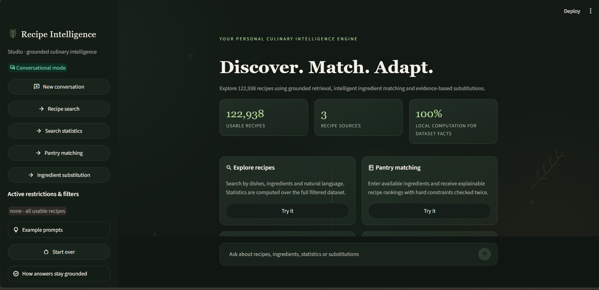
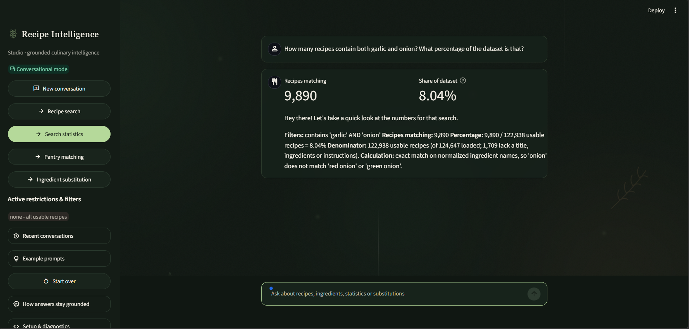
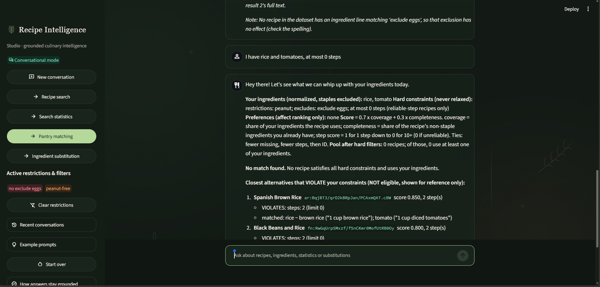
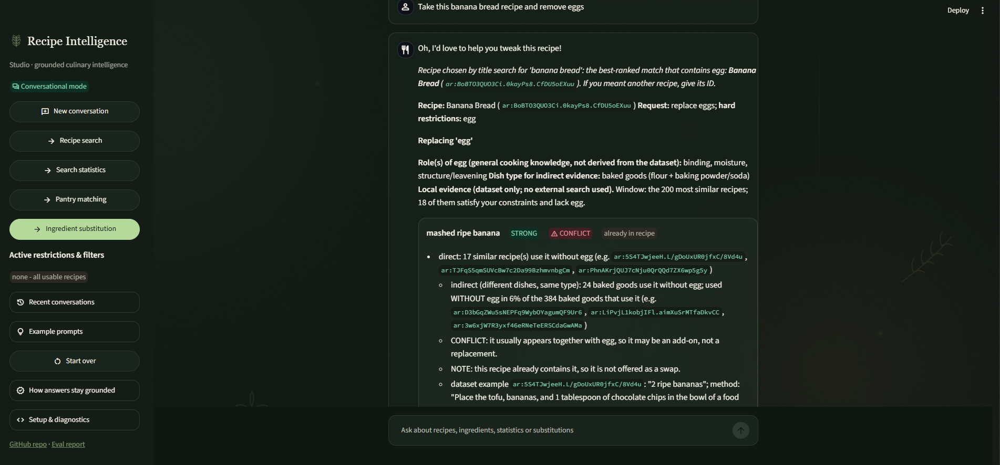
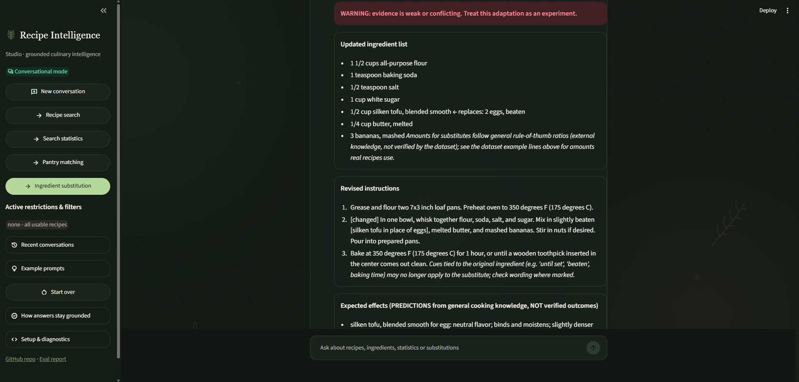

# Recipe Chatbot

A conversational chatbot over the [Recipe Box dataset](https://eightportions.com/datasets/Recipes/)
(~125k recipes from Allrecipes, Epicurious and Food.com). It searches recipes, computes
statistics programmatically, matches recipes to ingredients you have, and adapts recipes
with evidence-based ingredient substitutions. **Facts are never generated by an LLM** — every
answer is retrieved or computed from the local dataset. An optional Gemini layer makes the
conversation natural (free-form phrasing, small talk, friendly rewording) while a programmatic
guardrail verifies that every recipe ID, number and safety note survives; without a key the
chatbot runs fully deterministically.

## Setup and running

Requires Python 3.10+ and ~2 GB disk for the dataset and caches.

```bash
# 1. install dependencies (a virtualenv is recommended)
python -m venv .venv
.venv\Scripts\activate          # Windows (source .venv/bin/activate on Linux/macOS)
pip install -r requirements.txt

# 2. get the data: download the dataset from https://eightportions.com/datasets/Recipes/
#    and place these three files in data/raw/ :
#      recipes_raw_nosource_ar.json
#      recipes_raw_nosource_epi.json
#      recipes_raw_nosource_fn.json

# 3. run the chatbot (first run builds the parquet cache and TF-IDF index, 1-3 min)
streamlit run app.py            # web UI at http://localhost:8501  (recommended)
# or the command-line interface:
python -m src.router
```

Both interfaces use the same `Bot` and session logic, so behavior is identical. The web UI
([app.py](app.py)) adds clickable example prompts and a "Start over" button; the CLI is handy
for scripted demos and the interview.

**Optional conversational mode:** set `GEMINI_API_KEY` (free key from
https://aistudio.google.com/apikey) in your environment or in `.streamlit/secrets.toml`
(git-ignored), or run the CLI with `python -m src.router --chat`. Gemini then understands
free-form messages and rephrases answers naturally; all facts still come from the engine.
Without a key everything works in rule-based mode.

The Gemini layer never supplies facts: it only translates the user message into an engine command
and rephrases the engine output. The rewrite guard checks IDs, numbers and safety markers, but it
does not judge prose accuracy, and the intent-translation step has no equivalent guard, so the
engine always prints the filters it actually applied. The default model is set in `src/gemini.py`
(override with `GEMINI_MODEL`); the one-shot baseline in `eval/llm_baseline.md` was run on
`gemini-2.5-flash`.

Example session:

```
you> Find a penne pasta recipe
you> I cannot have dairy                  <- refines the previous search
you> show 2                               <- full ingredients + instructions
you> How many recipes contain both garlic and onion? What percentage of the dataset is that?
you> I have eggs, onions, tomatoes and rice, no peanuts, at most six steps
you> Exclude eggs too                     <- updates the match
you> Replace the cream in recipe 1 without dairy
you> start over
```

Scripted demos: `python -m src.router --demo` (search/stats), `--demo-match` (matching),
`--demo-sub` (substitution).

## Screenshots

Captured from the running Streamlit app (Gemini conversational mode on; facts are still computed locally).







## Evaluation

```bash
python eval/run_eval.py         # 12 conversations, 25 turns, 57 programmatic checks
python eval/test_converse.py    # conversational-layer guardrails + fallback (no key needed)
python eval/llm_baseline.py     # one-shot LLM comparison (set GEMINI_API_KEY first)
```

See [eval/REPORT.md](eval/REPORT.md) for results, what failed during development and why,
and known limitations. Full transcripts are in [eval/transcripts.md](eval/transcripts.md),
and a results index plus a web-UI verification transcript are in [docs/](docs/README.md).
Each module also has a self-test: `python -m src.normalize`, `python -m src.stats`,
`python -m src.matcher`, `python -m src.search`, `python -m src.substitution`.

## Architecture

```
data/raw/*.json ── loader.py ──> recipes.parquet ── prepare.py ──> recipes_features.parquet
                                                                        │
app.py (Streamlit web UI) ─┐                                            │
converse.py (optional Gemini language layer: intent translation,        │
             grounded rephrasing with ID/number guardrail, fallback) ───┤
router.py (CLI + session context, rule-based intent parsing) ───────────┤
  ├── search.py        Task 1: TF-IDF ranking AFTER hard filters on the full dataset
  ├── stats.py         Task 1: pandas counts/averages/rankings over the full filtered set
  ├── matcher.py       Task 2: hard filters first, then explainable coverage scoring
  ├── subchat.py       Task 3: conversation glue for adaptation requests
  └── substitution.py  Task 3: local-evidence search, grading, updated list + instructions
 normalize.py / restrictions.py: shared ingredient normalization and restriction specs
```

### Design decisions

- **Retrieval.** Hard filters (include/exclude/restrictions/step limit) are boolean masks
  computed over **all 122,938 usable recipes**; TF-IDF (title boosted 3x + normalized
  ingredient keys, 1-2 grams) only *ranks* the survivors. Aggregates never use the top-k
  results — the population is defined by filters alone.
- **Stable IDs.** `{source}:{original key}` (e.g. `ar:nvQz...`). Original titles, ingredient
  lines and instructions are preserved; the only cleaning is removing the `ADVERTISEMENT`
  website artifact into a separate cleaned copy (`ingredients_raw` keeps the original).
- **Normalization** ([src/normalize.py](src/normalize.py)). Strip quantities/units/prep words,
  singularize, merge true synonyms (`scallion` → `green onion`). Product-changing forms are
  kept distinct: `ground beef` ≠ `beef`, `garlic powder` ≠ `garlic`, `egg white` ≠ `egg`.
  `butter or margarine` keeps the first option (documented limitation).
- **Ranking (matching).** `score = w_cov·coverage + w_comp·completeness (+ w_steps·step score)`,
  weights shown in every answer; preferences only shift weights. Ties: fewer missing
  ingredients, fewer steps, then ID. Matched/missing/extra ingredients and the arithmetic
  are printed for each result, and every hard constraint is re-verified after ranking.
- **Computation.** Counts, percentages, means, medians and rankings are pandas/Python
  operations with the filters, denominator and calculation rule stated in the answer.
  Step count = non-empty instruction lines; single-paragraph recipes are flagged unreliable
  and excluded from step-sensitive queries (with the excluded count reported).
- **Substitution evidence.** For a target ingredient, the system searches the 200 most
  similar recipes (similarity computed *without* the target) for compliant recipes using
  each candidate substitute (direct evidence), plus the same dish type dataset-wide
  (indirect evidence). Evidence is graded STRONG/MODERATE/WEAK, co-occurrence conflicts
  lower confidence, and supporting recipe IDs are cited. Candidate lists and effect
  predictions are hand-written cooking knowledge and explicitly labeled as external
  hypotheses — only the *support* is computed from data. The output includes an updated
  ingredient list, revised instructions and labeled predictions.
- **Uncertainty and refusal.** No nutrition/time estimates (not in the dataset). Diets
  without an ingredient definition (vegan, gluten-free) are reported as NOT applied.
  Unknown ingredients/dishes produce explicit no-match answers. Unsupported substitution
  targets and egg-structure dishes (quiche) are refused. Restriction checks are text-based
  and every such answer carries a not-medically-safe disclaimer.
- **External search.** Not used. The assignment allows it as a secondary source; the bot
  states uncertainty instead.
- **Conversational layer (optional).** The three tasks are retrieval + computation + evidence
  aggregation, so the deterministic engine remains the only source of facts — reproducible and
  auditable, which is what the assignment grades. [converse.py](src/converse.py) adds Gemini
  strictly for language: it translates free-form messages into canonical engine commands and
  rephrases the grounded output. A programmatic guardrail (`grounding_ok`) rejects any rewrite
  that drops a recipe ID, number or safety marker, showing the raw engine output instead; any
  API failure falls back to the rule-based router. Small-talk replies are forbidden from
  stating dataset facts. Without a key the system is fully deterministic; the rule-based
  parser's trade-offs are described in [eval/REPORT.md](eval/REPORT.md).

## AI tools disclosure

AI coding assistance (Qoder Desktop) was used for pair-programming throughout: drafting
and reviewing modules, fixing parser bugs found by the eval, and writing the eval harness
and documentation. The architecture, scoring rules, normalization rules and evidence
grading were designed iteratively with the tool and are explained above and in code;
all behavior is verified by the reproducible eval suite.

## Repository layout

```
app.py  Streamlit web UI (wraps the same Bot as the CLI)
src/    chatbot modules (each has a runnable self-test)
eval/   run_eval.py, llm_baseline.py, REPORT.md, transcripts.md, results.json
docs/   results index + web UI verification transcript
data/   raw JSON + processed parquet (git-ignored; see setup)
```